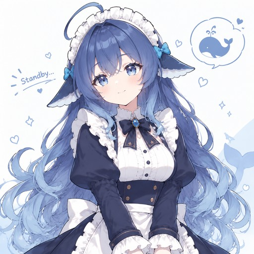
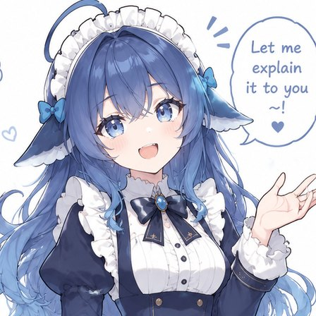
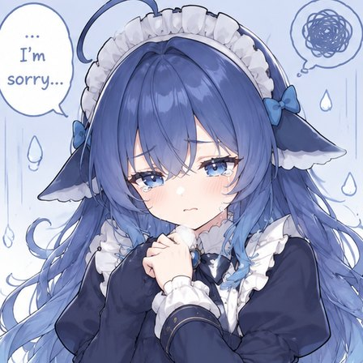

# Whale Dialog

A blue visual-novel dialogue view for the **DeepSeek Harness (DSH) Web GUI**. It replaces the ordinary chat transcript with a single dialogue frame, a whale-girl portrait that reacts to the conversation, and an in-frame composer — while keeping the conversation's memory intact.

Made by [0nlyLetter](https://github.com/0nlyLetter).



| Idle | Thinking | Speaking | Happy | Sad |
| --- | --- | --- | --- | --- |
|  |  |  |  |  |

[中文说明](#中文说明)

## Features

- **One reply at a time** — the latest assistant turn is shown in a visual-novel frame; earlier content is replaced visually, not deleted from the conversation.
- **Undersea stage** — layered water light, god rays, drifting whale silhouettes, a small school of fish, bubbles, a seabed silhouette and kelp, plus a soft glow behind the frame. Slow CSS animations, with a reduced-motion fallback.
- **Blue-and-white frame** — beveled double frame, ribbon bow, lace trim, rivets, a paper-whale watermark and a centered name plate under the portrait.
- **Five expressions** — idle, thinking, speaking, happy and sad. The first three follow the turn lifecycle (waiting / replying / idle); happy and sad are selected from the latest user message with a small keyword-and-emoji sentiment heuristic, then shown for a few seconds after the reply settles.
- **Typewriter reveal** — a click (or a click on the text) reveals the whole reply immediately; reduced-motion users get the full text at once.
- **Soft chime** — a short Web Audio chime on a new assistant turn; can be disabled in settings.
- **In-frame composer** — text + send, attachments, model selector, reasoning-effort slider and permission switcher, without leaving the dialogue box.
- **Settings page** — upload a portrait, change the name, move the portrait to either side, adjust frame width and font size, toggle the chime.

## Requirements

- A DSH installation with the Web GUI and client plugin bundles (`conversation.view` / `settings.section` slots).
- Node.js 18+ for building and testing. The plugin itself has no runtime dependencies.
- A modern Chromium-based browser for the Web GUI.

## Quick start

```bash
git clone https://github.com/0nlyLetter/dsh-whale-dialog.git
cd dsh-whale-dialog
npm run build
npm test
```

The build reads `tools/client.template.js` and the five JPEGs in `assets/`, embeds them as data URLs, and writes the single-file client bundle `client.js`. No bundler or package installation is required.

### Configure the target conversation

The view is intentionally session-scoped. Open `tools/client.template.js` and replace the placeholder:

```js
const TARGET_SESSION = 'session-REPLACE-WITH-YOUR-SESSION-ID'
```

with the id of the conversation that should use the visual-novel view. Rebuild with `npm run build`.

The session id is the id DSH uses in its conversation preference keys (`dsh.conversation.<sessionId>`); you can read it from the Web GUI's local storage or from the session URL. If the id does not match, the plugin renders a small guard card instead of taking over the transcript, and other conversations keep their normal chat UI.

For a quick trial, you can point it at a session you own; there is no API key or account credential in this repository.

### Install as a local DSH plugin

This package is a DSH client plugin bundle. Place the repository folder where your DSH profile can resolve the package name `@local/dsh-whale-dialog` (a link or copy into the profile's local package area is enough), then register the bundle row shipped in `cordis.patch.yml`:

```yaml
- insert:
    - id: whale-dialog
      name: '@local/dsh-whale-dialog'
```

Enable it in your profile and reload the Web GUI. The plugin seeds the view preference for the configured session and also registers a **鲸鱼对话** entry in the view switcher. If you change the target session later, rebuild and reload.

## Using the composer

The in-frame bar mirrors the important parts of the official DSH composer:

- **Attachments** — images and files enter the same draft-attachment pipeline as the official composer. They upload in the background; the send button stays disabled until the uploads are ready, and failed uploads are marked on the chip.
- **Model** — lists the session's available models grouped by provider, using the same per-session model directory as the official composer. The choice applies to the next request.
- **Reasoning effort** — a magnet slider: the thumb follows the pointer continuously, and on release it glides to the nearest advertised effort level. Click a tick or use the arrow keys to move one level at a time.
- **Permission** — switches the current session through the official `/permission` command. Read Only / Workspace Write / Full access are offered; Full access asks for a second confirmation first.

## Settings

Open the gear at the top-right of the view (or the plugin's settings section):

- portrait upload with preview and confirm
- name plate text (default `deepseek`)
- portrait on the left or right
- frame width and dialogue font size
- chime on/off

Settings are stored in `localStorage` under `dsh.whale-dialog.settings`; the portrait and name use per-session keys when a target session is configured.

## Project layout

```
.
├─ client.js                 generated single-file client bundle (committed)
├─ cordis.patch.yml          bundle patch that inserts the plugin row
├─ index.js                  host half (no host behaviour)
├─ icon.svg
├─ locale/{en,zh}.json
├─ assets/                   five square portrait JPEGs
├─ tools/
│  ├─ client.template.js     source of truth for the client plugin
│  ├─ build.mjs              embeds the portraits and writes client.js
│  ├─ test_client.mjs        render / portrait / settings checks
│  ├─ test_send.mjs          send path and in-view settings checks
│  ├─ test_typing.mjs        typewriter reveal checks
│  ├─ test_emotion.mjs       mood reaction checks
│  └─ check_css.mjs          CSS structure check
└─ package.json
```

## Development notes

- `npm run build` is idempotent: it always regenerates `client.js` from the template and assets.
- `npm test` runs tiny fake-React harnesses against the generated bundle; no browser is required.
- The client is a single ES module loaded through `window.__ModuleLoader__.load(...)`. It registers:
  - `conversation.view` (id `whale-dialog`, order 20) — the visual-novel view;
  - `settings.section` (id `whale-dialog`, order 40) — the settings page.
- Character art lives in `assets/`; replace the five JPEGs (ideally square) and rebuild to use your own.
- The composer controls rely on DSH client services (`modelDirectories`, `conversation`) and the `/permission` command. They are intentionally thin adapters; if a future DSH release changes those internals, the text/send path and the view still work, while a control may need updating.

## Security and privacy

No API keys, tokens or credentials are included in this repository. The plugin runs entirely in the Web GUI and uses the host's existing authentication; it never reads or stores provider credentials. Preferences and portraits are kept in the browser's `localStorage`.

The sentiment detector is a local keyword/emoji heuristic. It does not call a model and does not send your messages anywhere.

## Known limitations

- The view is gated to one configured session by design; there is no multi-session dashboard.
- Happy/sad reactions are approximate and deliberately conservative; neutral messages keep the idle portrait.
- The in-frame composer uses a subset of the official composer (no slash-command palette, queue controls, stop button or image previews inside the frame). The official composer remains available below if you need those.
- Tested on Windows with the DSH Web GUI's Chromium runtime; other platforms should work but are not verified.
- The reasoning-effort slider only appears when the selected model advertises effort levels.

## License

The source code is released under the [MIT License](LICENSE).

The character artwork in `assets/` was provided by the project author and is included for this project's demonstration. It is not covered by the MIT license; please ask the author before reusing the artwork elsewhere.

## 中文说明

这是一个给 **DeepSeek Harness Web GUI** 用的蓝色视觉小说对话框插件：把普通聊天记录换成一屏一句的对话框、右侧角色立绘和框内输入栏，同时保留完整对话记忆。

- 海底舞台：水面光、光柱、远处的鲸鱼、鱼群、气泡、海床与海草
- 蓝白双层框体：蝴蝶结、蕾丝边、铆钉、纸鲸鱼水印、立绘下方的居中名字牌
- 五套表情：待机、思考、说话、开心、难过；开心/难过按你最近一句话的情绪粗略判断
- 逐字浮现，点击立即显示全文；新回复有轻提示音
- 框内输入栏：附件、模型、推理强度滑条（跟随鼠标、松手吸附）、权限
- 设置页可换立绘、改名字、立绘左右、框体宽度、字号、提示音

安装：`npm run build` 生成 `client.js`，把仓库目录作为本地包 `@local/dsh-whale-dialog` 接入 DSH profile，启用 `cordis.patch.yml` 里的插件行；再把 `tools/client.template.js` 里的 `TARGET_SESSION` 换成你的会话 id，重新 build。

代码使用 MIT 协议；`assets/` 中的角色图片仅用于本项目展示，不在 MIT 授权范围内。
